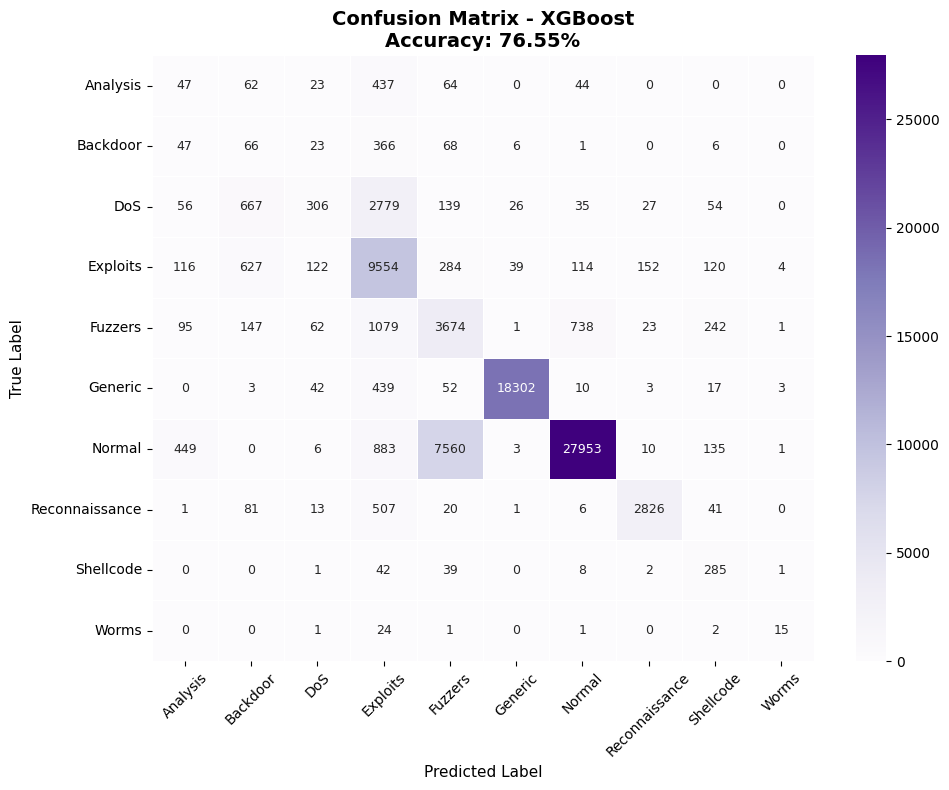

# Network Intrusion Detection: Dempster-Shafer vs XGBoost on UNSW-NB15

Undergraduate thesis project (Informatics, Universitas Gunadarma, 2026) that compares machine-learning approaches for **multi-class network intrusion detection** on the UNSW-NB15 dataset (9 attack types + normal traffic).

The main question: can a **Dempster-Shafer Theory (DST)** ensemble, which fuses the probabilistic outputs of Random Forest and SVM, beat a single strong model like **XGBoost**?

## Overview

- **Dataset:** UNSW-NB15 (175,341 training records, 82,332 testing records, 49 attributes)
- **Task:** multi-class classification over all 10 classes (Normal, Generic, Exploits, Fuzzers, DoS, Reconnaissance, Analysis, Backdoor, Shellcode, Worms)
- **Models:** Random Forest, SVM, XGBoost, and a Dempster-Shafer combination of RF + SVM
- **Metrics:** accuracy, precision, recall, F1-score, confusion matrix, computation time

## Approach

1. **Data loading:** official training and testing split of UNSW-NB15
2. **Preprocessing:** data cleaning, label encoding for categorical features (`proto`, `service`, `state`), and `StandardScaler` normalization for SVM
3. **Training:** Random Forest, SVM (`probability=True` so it outputs class probabilities), and XGBoost
4. **Dempster-Shafer fusion:** combine the probability outputs of RF and SVM as evidence using Dempster's rule of combination
5. **Evaluation:** compare all four methods on the test set

## Results

| Model | Accuracy | Precision | Recall | F1-score | Time (s) |
|---|---|---|---|---|---|
| Random Forest | 75.43% | 84.11% | 75.43% | 77.80% | 5.03 |
| SVM | 70.51% | 81.57% | 70.51% | 71.30% | 5480.19 |
| Dempster-Shafer (RF + SVM) | 75.42% | 83.09% | 75.42% | 76.47% | 2.40* |
| **XGBoost** | **76.55%** | 83.30% | **76.55%** | 77.78% | 8.44 |

\*For Dempster-Shafer, the time covers only the evidence combination step, not the training of RF and SVM.

**Key findings**

- XGBoost reached the highest accuracy and was far faster to train than SVM (about 8 seconds vs. about 5,480 seconds).
- Dempster-Shafer fusion improved on standalone SVM (75.42% vs. 70.51% accuracy), but did not outperform XGBoost.
- Random Forest had the highest precision (84.11%).

<!-- Optional: add your confusion matrix images from the results/ folder -->
<!--  -->

## Limitations

- SVM was trained on a **30,000-sample subset** because of its computational cost on the full training set, which likely holds its score down.
- Overall accuracy (about 76%) is moderate, which is common for the full 10-class UNSW-NB15 problem because several attack classes overlap heavily in feature space.
- No hyperparameter tuning or class-imbalance handling beyond the baseline setup.

## Project structure

```
.
├── ids_unsw_nb15.ipynb      # full pipeline: preprocessing, training, DST fusion, evaluation
├── docs/
│   └── penulisan-ilmiah.pdf # full written thesis (Bahasa Indonesia)
├── results/                 # figures and result tables
├── data/
│   └── README.md            # how to download the dataset
├── requirements.txt
└── .gitignore
```

## How to run

1. **Clone the repo**
   ```bash
   git clone https://github.com/USERNAME/ids-dempster-shafer-xgboost.git
   cd ids-dempster-shafer-xgboost
   ```
2. **Install dependencies** (Python 3.9+ recommended)
   ```bash
   pip install -r requirements.txt
   ```
3. **Download the dataset** and place the two CSV files in the `data/` folder. See [data/README.md](data/README.md).
4. **Run the notebook** `ids_unsw_nb15.ipynb` from top to bottom.

> Note: training the SVM takes a long time (it took roughly 90 minutes in my setup). To test quickly, lower the SVM sample size in the notebook.

## Thesis document

The full written thesis (in Bahasa Indonesia) is available in [`docs/penulisan-ilmiah.pdf`](docs/penulisan-ilmiah.pdf).

## Tech stack

Python, pandas, NumPy, scikit-learn, XGBoost, Matplotlib, Jupyter

## Reference

Moustafa, N., & Slay, J. (2015). *UNSW-NB15: a comprehensive data set for network intrusion detection systems.* Military Communications and Information Systems Conference (MilCIS).

## License

Code is released under the MIT License. The UNSW-NB15 dataset belongs to its authors (UNSW Canberra) and is subject to its own terms.